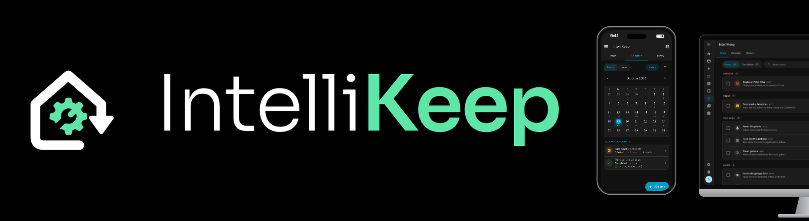
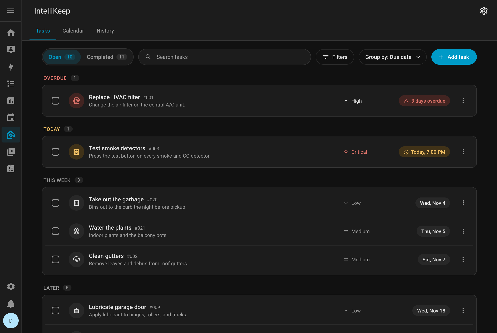
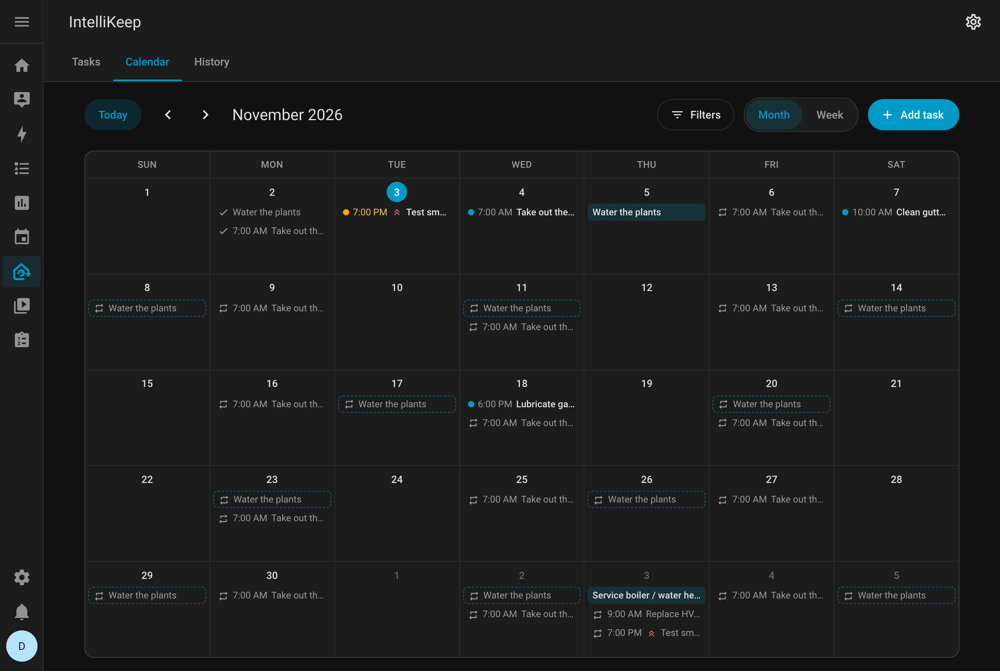
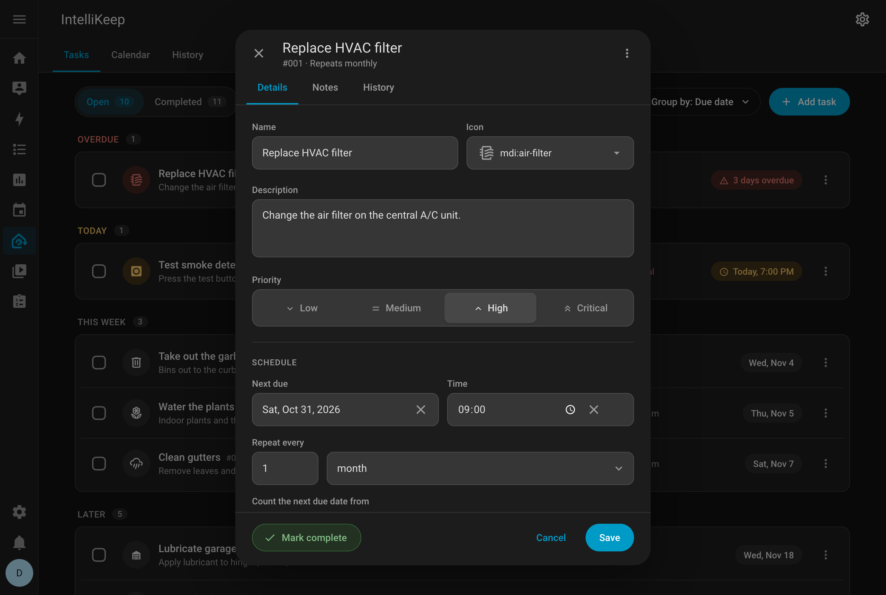
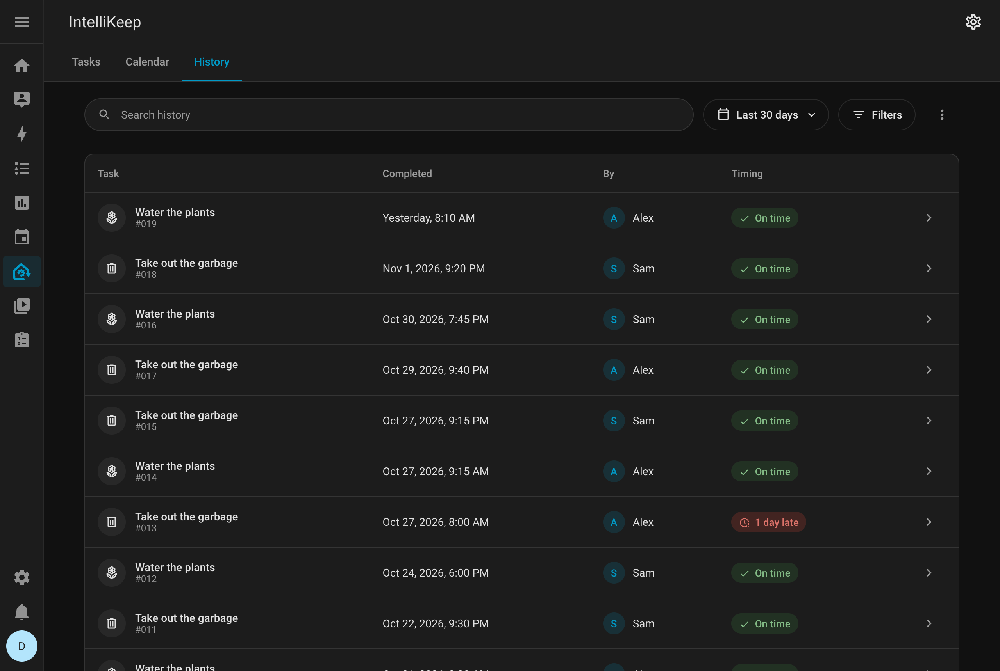
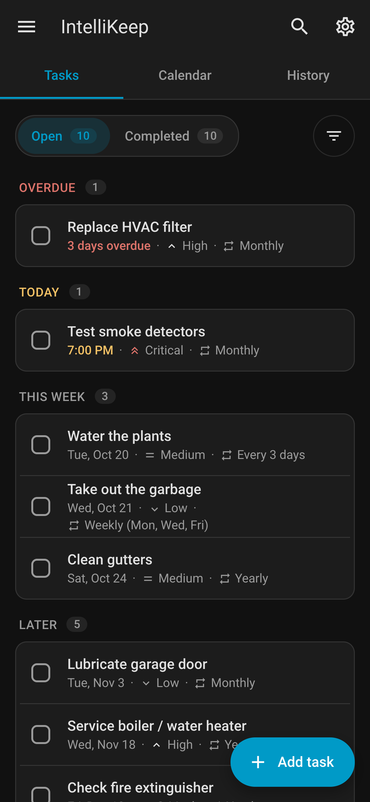
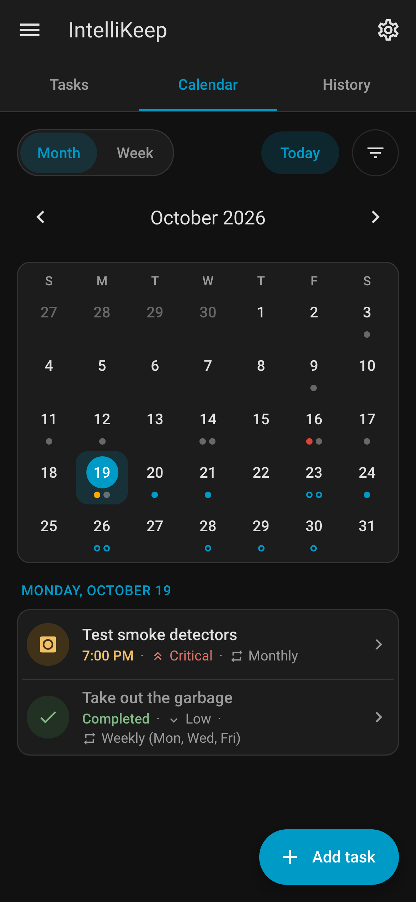
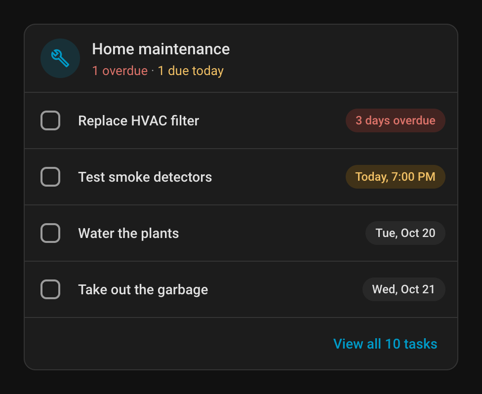

# IntelliKeep



[](https://henriquekraemer.github.io/intellikeep-doc/)
[](https://hacs.xyz)
[](https://github.com/henriquekraemer/intellikeep/actions/workflows/tests.yml)
[](https://github.com/henriquekraemer/intellikeep/actions/workflows/validate.yml)
[](LICENSE)

IntelliKeep is a free, open-source Home Assistant integration for keeping track of home maintenance tasks. Use it to keep every household chore in one place, from a monthly HVAC filter swap to an annual boiler service, with reminders and a full history of what was done and when.

**[Read the documentation](https://henriquekraemer.github.io/intellikeep-doc/)** for setup, every feature, the actions and automation examples. It is available in English, Portuguese and Spanish.

---

## Features

- One-time and recurring tasks that repeat every N days, weeks, months or years, counted from the completion or from the due date
- Weekly tasks can be pinned to specific days of the week, such as garbage collection on Mon/Wed/Fri
- Four priority levels (low, medium, high, critical), shown as an icon and a label
- An icon per task, picked from the Material Design Icons
- Link a task to a Home Assistant area or a specific device
- Timestamped notes per task, with author tracking, that you can add, view and delete
- An activity log per task covering edits, completions, reopens and note changes
- Calendar tab with month and week views laid out like Home Assistant's calendar, the future repeats of recurring tasks, filters by area, device and priority, and tasks added by clicking a day
- Execution history you can filter by area or device, with configurable columns, CSV export and print support
- Reminders through Home Assistant's persistent notifications, plus an optional mobile push service
- Three sensors: `sensor.intellikeep_tasks_due_today`, `sensor.intellikeep_tasks_overdue` and `sensor.intellikeep_next_due_task`
- A to-do list (`todo.intellikeep_tasks`) for Home Assistant's To-do lists and a calendar (`calendar.intellikeep_tasks`) for its Calendar, calendar cards and calendar triggers
- Responsive panel that works on desktop and mobile and follows the Home Assistant UI, in English, Portuguese and Spanish
- A Lovelace card for showing due and overdue tasks on a dashboard

---

## Screenshots

| Tasks | Calendar |
|:---:|:---:|
|  |  |
| **Task dialog** | **History** |
|  |  |

| On a phone | | Dashboard card |
|:---:|:---:|:---:|
|  |  |  |

---

## Installation

IntelliKeep needs Home Assistant 2026.1 or later.

1. Open HACS, go to Integrations, then Custom repositories
2. Add `https://github.com/henriquekraemer/intellikeep` with the category **Integration**
3. Install **IntelliKeep**
4. Restart Home Assistant
5. Go to **Settings → Devices & services → Add integration** and search for **IntelliKeep**

The IntelliKeep panel then shows up in the sidebar. To install without HACS, see [Manual installation](https://henriquekraemer.github.io/intellikeep-doc/installation/manual). Coming from 1.x? See [Upgrading from 1.x](https://henriquekraemer.github.io/intellikeep-doc/installation/upgrading).

---

## Documentation

| Topic | |
|---|---|
| [Configuration](https://henriquekraemer.github.io/intellikeep-doc/configuration) | Setup options, entity IDs, language and the panel's settings |
| [Tasks](https://henriquekraemer.github.io/intellikeep-doc/features/tasks) | Creating tasks, repeats, weekdays, notes and the activity log |
| [Calendar](https://henriquekraemer.github.io/intellikeep-doc/features/calendar) and [History](https://henriquekraemer.github.io/intellikeep-doc/features/history) | The panel's Calendar and History tabs |
| [To-do list & calendar](https://henriquekraemer.github.io/intellikeep-doc/features/todo-and-calendar) | `todo.intellikeep_tasks` and `calendar.intellikeep_tasks` |
| [Notifications & sensors](https://henriquekraemer.github.io/intellikeep-doc/features/notifications) | When reminders are sent, and what the sensors report |
| [Lovelace card](https://henriquekraemer.github.io/intellikeep-doc/lovelace-card) | Card options, and the resource for YAML-mode dashboards |
| [Actions](https://henriquekraemer.github.io/intellikeep-doc/services) | Every `intellikeep.*` action and its fields |
| [Automations](https://henriquekraemer.github.io/intellikeep-doc/automations) | Examples with the events, the calendar trigger and the actions |
| [Troubleshooting](https://henriquekraemer.github.io/intellikeep-doc/troubleshooting) | Common problems, known limitations and how to remove IntelliKeep |

---

## Development

The backend tests and the frontend build run in Docker, so you don't need Python or Node.js installed:

```bash
./run-tests.sh          # Python tests
./build-frontend.sh     # Build the panel and the card into custom_components/intellikeep/frontend/
```

The built bundles are committed, since HACS installs straight from the repository: rebuild and commit them after any frontend change. See [Building the frontend](https://henriquekraemer.github.io/intellikeep-doc/development/building) and [Running tests](https://henriquekraemer.github.io/intellikeep-doc/development/testing) for the details.

Found a bug or have an idea? [Open an issue](https://github.com/henriquekraemer/intellikeep/issues).

---

## License

MIT © [Henrique Kraemer](https://github.com/henriquekraemer)
